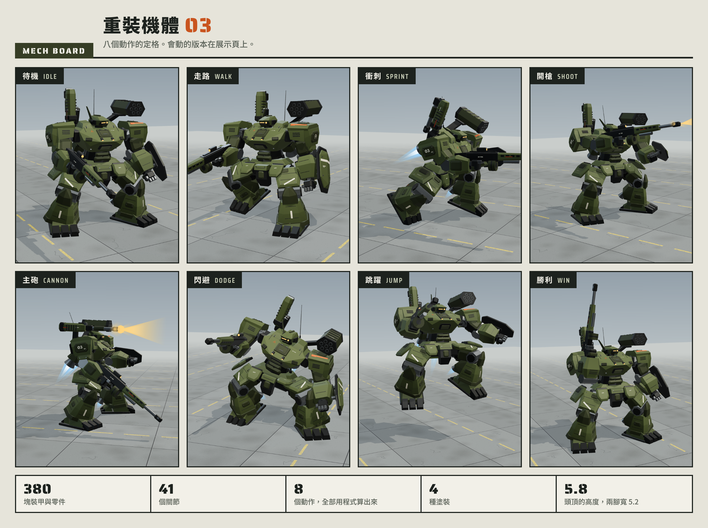

# Mech

A store of mech models, kept for any future use. That is all this repository is for.

Each model is saved as a glTF binary, together with the code that builds it and a board to look at it on.

## Models

| Model | File | Motions | Live board |
|---|---|---|---|
| Heavy mech 03 | `model/heavy_mech_03.glb` | 10 | https://sunrise201238-sys.github.io/Mech/ |



## Heavy mech 03

A squat, wide machine in slab armour, built entirely from code, with ten motions. The design is original.

### The live board

https://sunrise201238-sys.github.io/Mech/

Turn the mech, play its motions, take its weapons off and put them on, lay them out on their own, change its paint and its build, or look at its frame alone, in a browser, with nothing to install. The mech stays in sight while any control is worked: a wide window shows the stage and every control at once with nothing to scroll, a narrower one scrolls only the controls, and on a phone the stage holds to the top of the screen. GitHub Pages serves it from this repository's `gh-pages` branch.

### The saved settings

This look was chosen on the board on 20 November 2026 and is the default. The four build sliders read 1.00 at it.

| Setting | Value |
|---|---|
| Bulk | 1.00 |
| Shoulders | 1.00 |
| Legs | 1.00 |
| Head | 1.00 |
| Paint | Olive |
| Edge lines | Off |
| Tour through the motions | Off |

A slider's number is a multiple of the chosen look. In the model's own numbers that look is bulk 1.25, shoulders 0.81, legs 0.85 and head 1.12, which is `BUILD_BASE` in `src/frames/heavy.js`; `BUILD_DEFAULT` in `src/bench.js` is the four ones. Each slider has 1.00 in the middle of its travel and runs from 0.80 to 1.20. Below 1.00 the bulk slider brings the hips in in step with the pelvis, and the feet with them, so a thin build keeps its thighs under its hips; above 1.00 the hips go out more slowly than the body widens. The mech holds together in all ten motions at the ends and the corners of that range.

The paint is the first entry of `PALETTES` in `src/bench.js`. The board's sliders still move all four, and its paint buttons still offer slate, desert and night.

### The model

- Rigid parts on a tree of 43 joints. There is no skin: a part never bends, it rides its joint.
- 394 armour plates and parts. Each joint's parts are merged by material, which leaves 164 meshes and 13,033 triangles.
- It faces +Z, its own left is +X, and it stands on y = 0.
- It is built in its own units and stood in the scene at a scale of 1.15. At the saved settings the head tops out near 6.0, the feet span 5.2 from edge to edge, and its tallest point, the top of the folded cannon, reaches 7.5.
- Shade is baked into the vertex colours: a tint for each panel, a fall of tone down each panel, and darkening where parts crowd each other.
- The stencil marks come from one sheet, 1024 by 512, drawn when the model is built.
- The head is a helmet of sloped plates, a wedge that is low at its steel nose and rises toward the back. Under the nose is its one eye, a pane set in a broad steel frame. Both are a little narrower at the top than at the foot, and the frame's sides run parallel to the pane's. The nose, a cheek plate each side and the jaw close right up to the frame, the cheeks leaning in along its sides, and each of them is sloped, none facing flat to the front.
- Loadout: a heavy gun in the right hand, a shield on the left forearm, a folding cannon on the right of the back, a seven tube missile pod over the left shoulder, two main thrusters and one on each calf.

### The layers

The mech is put together from four layers of parts, each in its own file, and the motions that belong to its frame, so that a later mech can keep some and change others.

| Layer | Parts | What it is |
|---|---|---|
| Frame | 86 | The skeleton and what a mech keeps whatever it wears or carries: the joints and their sizes, the dark inner structure, the hinges the skirt plates and shoulder blocks hang from, the place on its back for a backpack, the thrusters on its calves and the aerial on its head. It also says what the four build sliders do |
| Armour | 215 | Every painted plate, with the seams, bolts, hatches, lamps and stencil marks that sit on it. This line is made for the heavy frame alone |
| Backpack | 15 | The twin thruster pack: two main thrusters, a whip aerial, and a side each for a weapon to mount on. A frame can carry any backpack |
| Weapons | 78 | The cannon, the missile pod, the shield and the rifle. Each can be taken off on its own, and each is bound to one of the frame's motions |
| Motions | | The ten motions belong to the frame. A backpack or a weapon brings the part of a motion that is its own: the pack the burn of its thrusters, the cannon how it unfolds and kicks, the rifle its flash, the missile pod its salvo |

The frame is kept light, since a game draws it under the armour all the time: on its own it is 3,012 triangles in 45 meshes, where the whole mech is 13,033 in 164. Under this armour it had nothing in its chest, its forearms or behind its calves, where the armour is the body. Six plain blocks join those places so the frame holds together to the eye: a spine from the waist to the neck, a yoke between the shoulder mounts, a bone in each forearm and a strut to each calf thruster. They are 72 triangles in all, with no joint and no mesh of their own. Each end is sunk into a part the frame already had, and the rest keeps clear of the armour's inner faces. In its armour the mech looks as it did: set beside pictures of the build before them, a picture changes by a few dozen pixels at most, at the edge of a shadow or in the gap under the chest when it leans back. The board's 骨架 button shows the frame alone.

Until 21 November 2026 all of this was one piece of code. The finishing pass tints each panel in the order it meets it, so the order the parts were made in is part of the look. `src/models/heavy_mech_03.js` keeps that order: every part that was there then comes out as it did, byte for byte, and what has been added since takes its place and its tint after them.

### The motions

| Name | Length | Plays | What happens |
|---|---|---|---|
| Idle | 3.2 s | Loops | Stands wide and low, breathes, looks about |
| Walk | 1.5 s | Loops | A heavy, swaying step |
| Sprint | 0.8 s | Loops | A boost dash, leaning in, thrusters lit |
| Shoot | 0.6 s | Loops | Three shots from a braced stance, side on behind the shield, each with its kick |
| Cannon | 2.8 s | Once | The cannon swings over the shoulder, the barrel swings up and out, it fires, it folds away |
| Missile | 2.8 s | Once | The body does as it does for the cannon, which stays folded: the pod sends off seven missiles one after another |
| Dodge | 2.0 s | Once | A boosted lunge to the side |
| Guard | 2.4 s | Loops | Behind the shield held across the chest, low and side on, the gun let down at the side |
| Jump | 1.5 s | Once | Crouch, rise on the thrusters, land |
| Win | 2.6 s | Once | Stands up, brings the gun up beside the head |

Each motion is a function of time that poses the joints. The legs are placed by reaching for where a foot should be, and in Shoot the gun arm is turned until the gun points down its line. The motions are then sampled 30 times a second into plain keyframe clips, so an engine or a glTF viewer can play them as they are.

Shoot, Cannon and Missile are the frame's firing motions, and each weapon is bound to one of them: the rifle to Shoot, the cannon to Cannon, the missile pod to Missile. On the board a weapon's own button plays its motion, and the motion cannot be played while its weapon is off. The shield is bound to Guard, but Guard is the frame's own: a mech that carries no shield still has it.

The clips keep the mech in place. On the board the ground passes under Walk and Sprint from the mech's front to its back, the model is lifted 2.5 for Jump and the ground slides 3 for Dodge. Those movements belong to the board and are not in the clips.

### What the model file holds, and what it does not

It holds the parts, the joints, the ten clips, the paint as plain materials, the baked shade as vertex colours, and the stencil sheet as one picture.

It does not hold the board's ground, sky or lights, nor the thin edge lines the board can draw. The thruster plumes and muzzle flashes are in it as plain unlit shapes that fade along their length. They are scaled to nothing whenever they are not firing.

The glTF validator reports 0 errors and 0 warnings for the file. It has not been opened in any other program yet.

## What is in this repository

| Path | What it is |
|---|---|
| `model/heavy_mech_03.glb` | The model with its ten motions, at the saved settings |
| `model/heavy_mech_03_poster.png` | A still of each motion |
| `dist/index.html` | The board, built. The live address serves this file. It also opens straight from the folder |
| `src/frames/heavy.js` | The heavy frame: the joints, the inner structure, the armour's hinges, the place for a backpack, the calf thrusters and the aerial, and what the build sliders do |
| `src/armor/heavy_slab.js` | The slab armour made for that frame |
| `src/backpacks/twin_thruster.js` | The twin thruster pack |
| `src/weapons/` | The cannon, the missile pod, the shield and the rifle, a file each: what it mounts on, which motion it is bound to, how it is built and what it does in that motion |
| `src/motions/heavy.js` | The heavy frame's ten motions |
| `src/models/heavy_mech_03.js` | Heavy mech 03: which frame, armour, backpack and weapons make it, and the order its parts were first made in |
| `src/bench.js` | What every layer is made with: the paints, the shapes, the stencil sheet, and the finishing pass |
| `src/mech.js`, `src/anim.js` | Putting a mech together from its layers, with or without each weapon, standing its weapons in a row on their own, and sampling a frame's motions into clips |
| `src/main.js`, `src/page.html` | The board itself |
| `tools/` | Small scripts that write the model file, check it, make the poster and publish the board |
| `CLAUDE.md` | The owner's working rules, which a coding session reads when it starts here |

## Building it

```
npm install
npm run build
```

That writes `dist/`. Open `dist/index.html` in a browser. It works straight from the file.

The tools need Playwright and a Chromium that can run WebGL. Run them from this folder.

```
npm run glb      # writes model/heavy_mech_03.glb from the board's own exporter
npm run check    # runs the glTF validator on it
npm run poster   # shoots a still of each motion and makes the poster
```

To put a new build on the live address, commit the fresh `dist/` and then publish it.

```
npm run pages    # puts the committed dist/ on the gh-pages branch, which GitHub Pages serves
```

`tools/shot.cjs` takes still pictures of any motion from any side. `tools/extremes.cjs` builds the mech at the ends of its sliders to see that nothing breaks.
